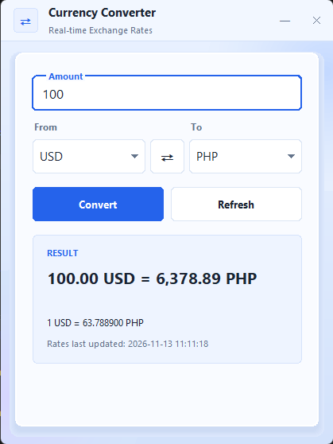

<div align="center">

# 💱 Real-Time Currency Converter

**A desktop app that converts currencies using live exchange rates.**


[Features](#-features) · [Quick Start](#-quick-start) · [Usage](#-how-to-use) · [Testing](#-running-the-tests) · [Project Structure](#-project-structure) · [Documentation](#-documentation) · [Troubleshooting](#-troubleshooting) · [Team](#-team)

</div>

---

## ✨ Features

| | Feature | Description |
|---|---|---|
| 🔁 | **Convert** | Convert an amount between any two supported currencies. Press **Enter** or click **Convert**. |
| 📈 | **Live rate** | Shows the rate used for every conversion, for example `1 USD = 63.039100 PHP`. |
| 🕒 | **Last updated** | Shows when the rates were last fetched, always visible. |
| ⏱️ | **Auto refresh** | Rates refresh automatically every hour, which stays well inside the free-tier quota. |
| 🔄 | **Manual refresh** | **Refresh** fetches new rates on demand, with a 30-second cooldown to protect the quota. |
| ⇅ | **Swap** | Exchange the source and target currencies with one click. |
| 🛡️ | **Input validation** | Rejects empty, non-numeric, negative, and unsupported inputs with a clear message. |
| 🧯 | **Safe failures** | Network and API errors show a plain message and keep the last good rates. |
| 🧵 | **Responsive window** | Network calls run in the background, so the window never freezes. |

---

## 📋 Requirements

| Requirement | Version / Notes |
|---|---|
| **Python** | 3.10 or newer |
| **Operating system** | Windows 10+, macOS, or Linux |
| **Tkinter** | Included with Python on Windows and macOS. On Linux, install `python3-tk` (for example, `sudo apt install python3-tk`). |
| **Internet connection** | Required. The app has no offline mode. |
| **ExchangeRate-API key** | Free key from [exchangerate-api.com](https://www.exchangerate-api.com/) |

---

## 🚀 Quick Start

### 1. Clone the repository

```bash
git clone https://github.com/0xJoshy/real-time-currency-converter.git
cd real-time-currency-converter
```

### 2. Create and activate a virtual environment

```bash
python -m venv .venv
```

| OS | Activate command |
|---|---|
| Windows | `.venv\Scripts\activate` |
| macOS / Linux | `source .venv/bin/activate` |

### 3. Install the dependencies

```bash
pip install -r requirements.txt 

or

./.venv/bin/python.exe -m pip install -r requirements.txt
./.venv/bin/python.exe src/main.py
```

### 4. Add your API key

Copy the example file and open the new `.env` file:

```bash
cp .env.example .env          # Windows: copy .env.example .env
```

Paste your key after the `=` sign:

```env
EXCHANGE_RATE_API_KEY=your_real_key_here
```

> 🔐 **Never commit `.env`.** It is already listed in `.gitignore`.

### 5. Run the app

Run it from the project root:

```bash
python src/main.py
```

A window titled **Real-Time Currency Converter** opens, and the status line shows **Rates updated.**

---

## 🖥️ How to Use

1. **Type an amount** in the *Amount* box, for example `100`.
2. **Pick currencies** from the *From* and *To* dropdowns. You can also type a code, such as `php`.
3. Click **Convert** or press **Enter**.
4. Read the result, the rate, and the *Rates last updated* time.
5. Click **⇅ Swap** to reverse the currencies, or **Refresh** to fetch new rates.

> ⏳ After a manual refresh, the button waits 30 seconds before it will fetch again.

### 📸 Screenshots

<p align="center">
  
</p>

> Add your own screenshots to the `screenshots/` folder, and update the image path above.

---

## 🧪 Running the Tests

The tests run without opening a window and without calling the live API.

```bash
python -m pytest
```

Expected output: all tests pass, with no failures.

| Test file | What it covers |
|---|---|
| `tests/test_currency.py` | Input validation (FR-06) |
| `tests/test_rate_client.py` | API client and error messages (FR-07) |
| `tests/test_rate_service.py` | Keeping the last good rates after a failed refresh |
| `tests/test_cooldown.py` | Manual refresh cooldown (FR-08) |
| `tests/test_swap.py` | Swap behavior (FR-09) |

---

## 🗂️ Project Structure

```
real-time-currency-converter/
├── src/
│   ├── main.py                  # Entry point
│   ├── config.py                # Loads the API key from .env
│   ├── controllers/
│   │   └── app_window.py        # Tkinter window (UI only)
│   ├── models/
│   │   ├── currency.py          # Input validation (FR-06)
│   │   └── rate_snapshot.py     # Immutable rate data
│   └── services/
│       ├── rate_client.py       # ExchangeRate-API client (FR-07)
│       ├── rate_service.py      # Keeps the last good rates
│       ├── cooldown.py          # Refresh cooldown (FR-08)
│       ├── converter.py         # Conversion coordinator (Strategy pattern)
│       └── strategy.py          # Conversion strategies
├── tests/                       # Automated tests (pytest)
├── docs/                        # SRS, API docs, architecture
├── screenshots/                 # App screenshots
├── .env.example                 # Placeholder for the API key
├── pytest.ini
├── requirements.txt
└── README.md
```

---

## 📚 Documentation

| Document | Description |
|---|---|
| [SRS](docs/SRS.md) | Requirements, scope, and acceptance criteria |
| [Architecture and Design Pattern](docs/architecture-and-design-pattern.md) | Module design and the Strategy pattern |
| [API Documentation](docs/api-documentation.md) | ExchangeRate-API endpoints, responses, and errors |

---

## 🛠️ Troubleshooting

| Problem | Solution |
|---|---|
| `ModuleNotFoundError: No module named 'tkinter'` (Linux) | Install `python3-tk` with your package manager. |
| `EXCHANGE_RATE_API_KEY is missing` | Create `.env` from `.env.example` and paste your key after `=`. |
| *The API key is invalid* | Copy the key again from your ExchangeRate-API dashboard. |
| *The API account is not active* | Confirm your email address with ExchangeRate-API. |
| *No internet connection* | Check your connection. The window keeps the last good rates. |
| *The API request limit has been reached* | Wait for the quota to reset, or reduce refreshes. |
| `ModuleNotFoundError` when running | Run `python src/main.py` from the project root, not from inside `src/`. |

---

## 👥 Team

**Programming Tools and Techniques · Section TN36**

- Bugarin, Kurt Gabriel
- Dumalaog, John Joshua
- Esteban, Errol Jay
- Guevarra, Aaron Qassem

---

## 🙏 Acknowledgments

- [ExchangeRate-API](https://www.exchangerate-api.com/) for the live exchange-rate data. Their [terms of use](https://www.exchangerate-api.com/terms) apply.
- Python's [Tkinter](https://docs.python.org/3/library/tkinter.html) and the [pytest](https://docs.pytest.org/) and [python-dotenv](https://pypi.org/project/python-dotenv/) libraries.
