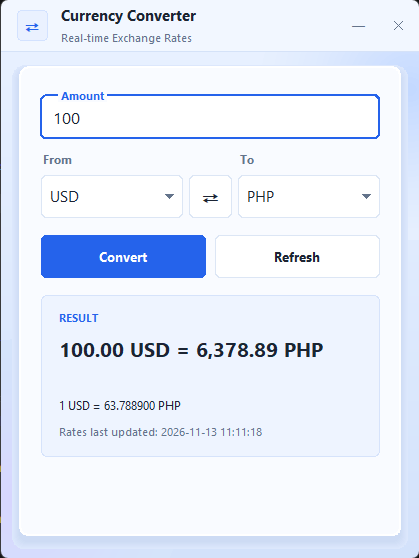
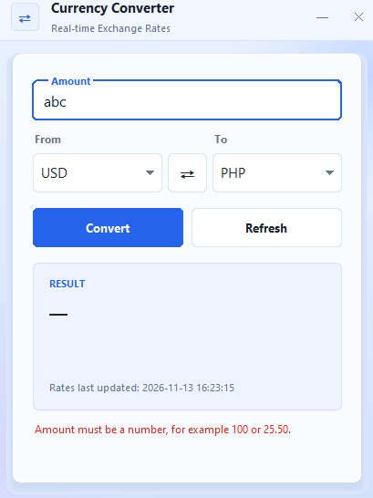
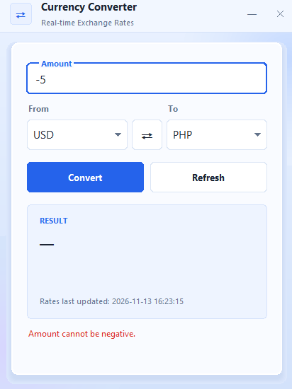
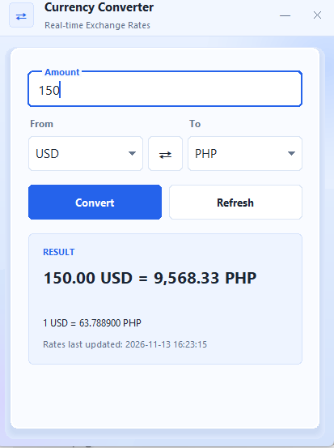
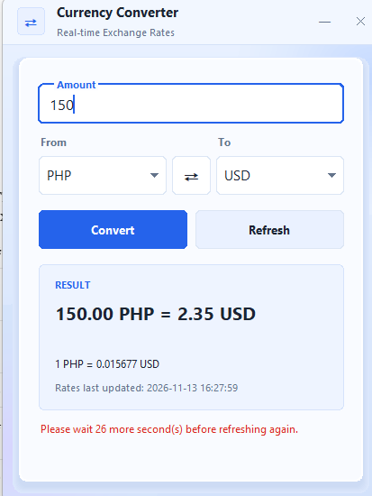
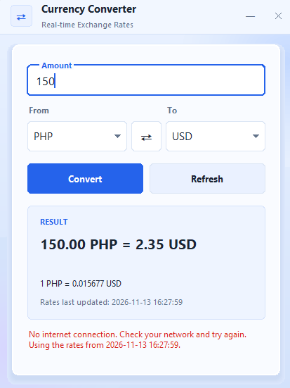

# User Manual

## 1. Getting Started

**Prerequisites**

- Python 3.10 or newer, with Tkinter. Tkinter comes with Python on Windows and macOS. On Linux, install `python3-tk`.
- An internet connection.
- A free ExchangeRate-API key, with your email confirmed.

**Setup**

1. Clone the repository and open the project folder in VS Code.
2. Create and activate a virtual environment, then install the requirements:
   ```
   python -m venv .venv
   pip install -r requirements.txt
   ```
3. Copy `.env.example` to `.env`, then paste your key after `EXCHANGE_RATE_API_KEY=`.
4. Run the app from the project root:
   ```
   python src/main.py
   ```

**Expected result.** A window titled "Real-Time Currency Converter" opens. After the first fetch finishes, the From and To boxes fill with currency codes (USD and PHP are preselected) and "Rates last updated" shows the current date and time.



---

## 2. Convert an Amount (FR-01, FR-02)

**Purpose.** Convert an amount from one currency to another using the current exchange rate.

**Prerequisites.** Rates have loaded. "Rates last updated" shows a time and the currency boxes are filled.

**Procedure**

1. Type an amount in the **Amount** box, for example `100`.
2. Choose the source currency in **From** and the target currency in **To**.
3. Click **Convert**, or press **Enter** in the Amount box.

**Expected result.** The result line shows the converted amount, for example `100.00 USD = 6,378.89 PHP`. The rate line shows the rate used, for example `1 USD = 63.788900 PHP`.


**Troubleshooting**

- _"Amount must be a number, for example 100 or 25.50."_ The amount has letters or symbols. Use digits, such as `25.50` or `1,000`.

  

- _"Amount cannot be negative."_ Enter zero or a positive amount.

  

- _"Please enter an amount."_ The Amount box is empty.
- _"Rates are not loaded yet. Click Refresh and try again."_ The first fetch has not finished, or it failed. Wait, or click **Refresh**.

---

## 3. Swap Currencies (FR-09)

**Purpose.** Reverse the From and To currencies.

**Procedure.** Click the **⇄** button between the two dropdowns.

**Expected result.** The two currencies exchange places. The previous result clears, so click **Convert** again to see the new amount.



---

## 4. View the Last Updated Time (FR-03)

**Purpose.** Show when the rates were last fetched.

**Procedure.** No action needed. The label **Rates last updated** is always visible at the bottom of the result box.

**Expected result.** The time changes after each successful refresh. Before the first fetch, it reads "not yet."

---

## 5. Refresh Rates Manually (FR-08)

**Purpose.** Fetch new rates without waiting for the automatic refresh.

**Procedure.** Click **Refresh**.

**Expected result.** The status line briefly shows "Updating rates...", then clears. The last-updated time changes.

**Cooldown.** After a refresh starts, the button waits 30 seconds. If you click again during that time, the status line shows "Please wait N more second(s) before refreshing again." This protects the API's free quota.



---

## 6. Automatic Refresh (FR-04)

**Purpose.** Keep rates current without any action.

**Behavior.** The app refreshes rates every hour in the background. This stays well inside the free-tier limit of about 1,500 requests a month.

**Expected result.** The last-updated time changes about once an hour.

---

## 7. Error Messages (FR-07)

If something goes wrong, the status line shows a plain message in red, and the last good rates stay on screen.

| Message                                                     | Meaning                              | What to do                                                                |
| ----------------------------------------------------------- | ------------------------------------ | ------------------------------------------------------------------------- |
| "No internet connection. Check your network and try again." | The app cannot reach the internet.   | Check your connection, then click Refresh.                                |
| "The request timed out. Please try again."                  | The service was too slow to answer.  | Click Refresh.                                                            |
| "The API key is invalid..."                                 | The key in `.env` is wrong.          | Copy the key again from your dashboard, save `.env`, and restart the app. |
| "The API account is not active..."                          | Your account email is not confirmed. | Confirm it with ExchangeRate-API.                                         |
| "The API request limit has been reached..."                 | The free quota is used up.           | Wait for it to reset.                                                     |
| "EXCHANGE_RATE_API_KEY is missing..."                       | No key in `.env`.                    | Create `.env` from `.env.example`.                                        |



---

## 8. Limitations

- Requires an internet connection. There is no offline mode.
- Converts one source currency to one target currency at a time.
- Rates come from ExchangeRate-API and may differ slightly from banks or other sites.

---
