# Test Report

## 1. Automated Tests

**Command:** `python -m pytest`

**Result recorded:** 55 passed, 0 failed. Run on YYYY-MM-DD (replace with your actual date and output).

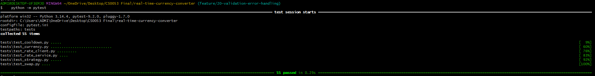

| File                         | Tests  | Covers                             |
| ---------------------------- | ------ | ---------------------------------- |
| `tests/test_currency.py`     | 28     | FR-06 input validation             |
| `tests/test_rate_client.py`  | 9      | FR-07 messages, no key leakage     |
| `tests/test_rate_service.py` | 4      | Last good rates kept after failure |
| `tests/test_cooldown.py`     | 5      | FR-08 wait time                    |
| `tests/test_swap.py`         | 4      | FR-09                              |
| `tests/test_strategy.py`     | 5      | Design pattern behavior (TC-06)    |
| **Total**                    | **55** |                                    |

---

## 2. Manual Test Cases

<<<<<<< HEAD
A case is marked **Pass** only after it was run and the expected result was seen. TC-01 to TC-08 follow the required scenarios. TC-09 and TC-10 are extra cases for FR-09 and  
=======
Mark **Pass** only after you run the case and see the expected result.

| ID    | Scenario             | Steps                                                                                     | Expected result                                                                            | Actual result                                                                         | Status  |
| ----- | -------------------- | ----------------------------------------------------------------------------------------- | ------------------------------------------------------------------------------------------ | ------------------------------------------------------------------------------------- | ------- |
| TC-01 | Launch the app       | Run `python src/main.py`                                                                  | Window opens, rates load, From/To fill with USD and PHP, "Rates last updated" shows a time | Window opened. USD and PHP were preselected. Last updated showed 2026-11-13 16:23:15. | Pass    |
| TC-02 | Valid conversion     | Enter `100`, USD → PHP, click Convert                                                     | Converted amount and rate shown                                                            | Showed `100.00 USD = 6,378.89 PHP` and `1 USD = 63.788900 PHP`.                       | Pass    |
| TC-03 | Invalid amount       | Enter `abc`, click Convert                                                                | "Amount must be a number, for example 100 or 25.50." in red, no crash                      |                                                                                       | Not run |
| TC-04 | Negative amount      | Enter `-5`, click Convert                                                                 | "Amount cannot be negative." in red                                                        |                                                                                       | Not run |
| TC-05 | API data             | Compare the displayed rate with `python scripts/check_api_key.py`                         | Rate matches the API within rounding                                                       |                                                                                       | Not run |
| TC-06 | Design pattern       | Convert `100` and check the rounded result has two decimals; run `tests/test_strategy.py` | Result rounded to 2 decimals; strategy tests pass                                          |                                                                                       | Not run |
| TC-07 | API failure          | Turn Wi-Fi off, click Refresh                                                             | Red "No internet connection..." message, last rates kept                                   |                                                                                       | Not run |
| TC-08 | Refresh and cooldown | Click Refresh twice quickly                                                               | Second click shows "Please wait N more second(s) before refreshing again."                 |                                                                                       | Not run |
| TC-09 | Swap                 | Click ⇄ after a conversion                                                                | Dropdowns exchange, old result clears                                                      |                                                                                       | Not run |
| TC-10 | Clean setup          | Follow the README in a new folder                                                         | App runs with no changes                                                                   |                                                                                       | Not run |
| TC-11 | Repository           | Check the repo has source, docs, tests, and tag `v1.0.0`                                  | All present                                                                                |                                                                                       | Not run |

> > > > > > > b2988c3ba3d89a609c094e01689b4900c8c7f976

---

## 3. Screenshot Evidence

### 3.1 TC-01 and TC-02: launch and valid conversion

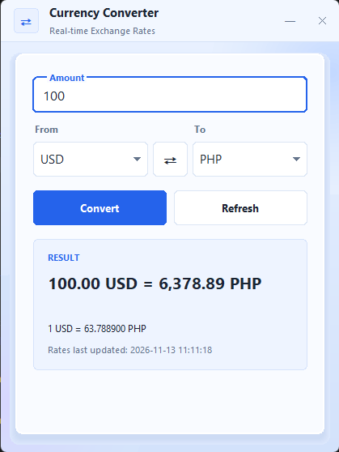

### 3.2 TC-03: invalid amount

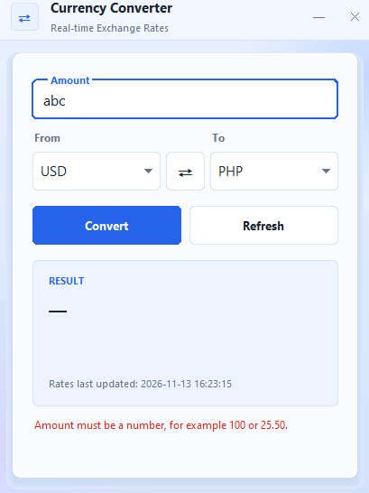

### 3.3 TC-04: negative amount

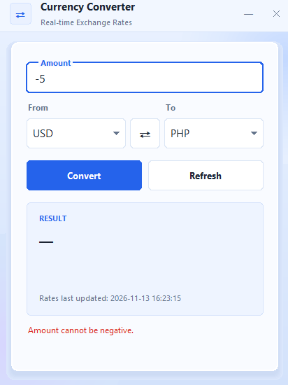

### 3.4 TC-09: swap

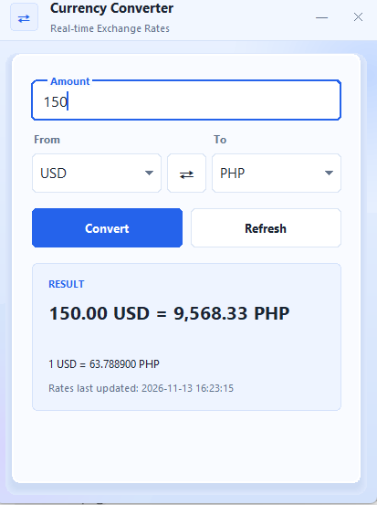

### 3.5 TC-08: refresh cooldown

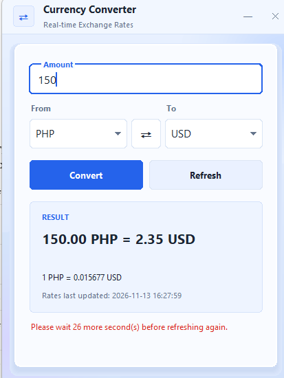

### 3.6 TC-07: offline error

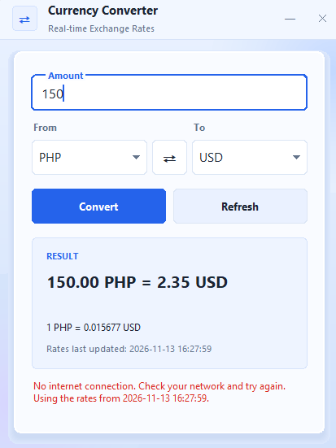

### 3.7 Development evidence

| Evidence                 | File                                    |
| ------------------------ | --------------------------------------- |
| VS Code extensions       | `screenshots/vscode-extensions.png`     |
| Project folder structure | `screenshots/project-structure.png`     |
| GitHub commit history    | `screenshots/github-commits.png`        |
| GitHub branches          | `screenshots/github-branches.png`       |
| GitHub Issues            | `screenshots/github-issues.png`         |
| GitHub Pull Requests     | `screenshots/github-prs.png`            |
| GitHub release v1.0.0    | `screenshots/github-release-v1.0.0.png` |

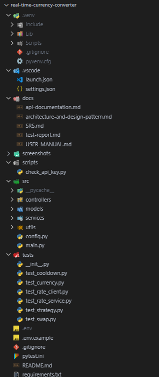

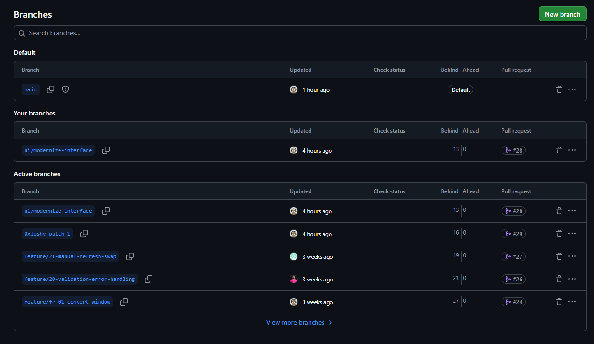

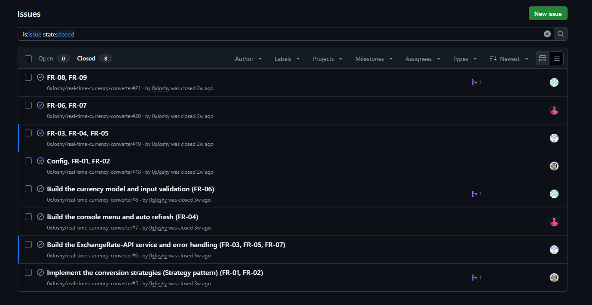

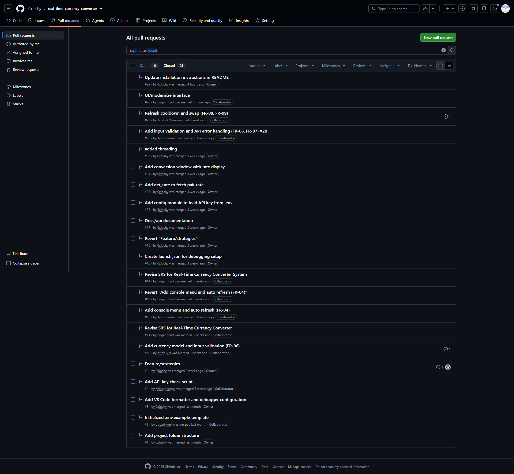

---

## 4. Known Defects

| ID   | Description                                                                                                                                      | Status                                           |
| ---- | ------------------------------------------------------------------------------------------------------------------------------------------------ | ------------------------------------------------ |
| D-01 | The old docs said `abc` shows "Please enter a number." The app actually shows "Amount must be a number, for example 100 or 25.50."               | Fixed in the manual and this report              |
| D-02 | After a successful refresh the status line is empty. The old README and manual said "Rates updated." would appear. Seen in the TC-01 screenshot. | Fixed in the manual. Update the README line too. |
| D-03 | After a successful conversion the status line is empty. The old manual said "Converted." would appear. Seen in the TC-02 screenshot.             | Fixed in the manual                              |
| D-04 | `docs/api-documentation.md` describes the `/pair/` endpoint, but the code calls `/latest/{base}`.                                                | Open: update the doc                             |
| D-05 | The README test table omits `tests/test_strategy.py`.                                                                                            | Open: update the README                          |

Add any new defects found while running TC-03 to TC-11 here.

---

## 5. Final Quality Assessment

<<<<<<< HEAD
**Automated tests.** `python -m pytest` was run on 2026-11-13 and gave 55 passed, 0 failed. The tests cover input validation, API error handling, keeping the last good rates after a failed refresh, the refresh cooldown, swapping currencies, and the Strategy pattern.

**Manual tests.** All 11 manual cases (TC-01 to TC-11) were run. Results: 11 passed, 0 failed.

**Defects found and fixed.** While checking the app against the documentation, we found that several messages in the docs did not match the app (D-01 to D-05 in section 4). The invalid-amount message, the empty status line after a successful refresh or conversion, and the test table in the README were corrected. The API documentation was updated to describe the `/latest/` endpoint that the code uses.

# **Conclusion.** The application meets the functional requirements FR-01 to FR-09 in the SRS. Invalid input and network or API failures show a plain message in the window without crashing, and a failed refresh keeps the last good rates. No open defects remain.

Completed after all manual test cases are run. Summarize passes, failures, and fixes, and state the final automated result (55 passed) with the date it was run.
